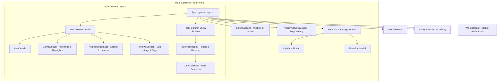
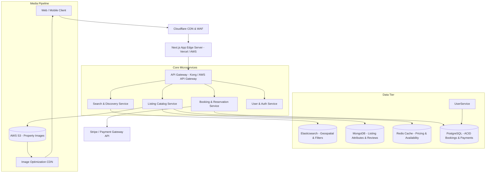
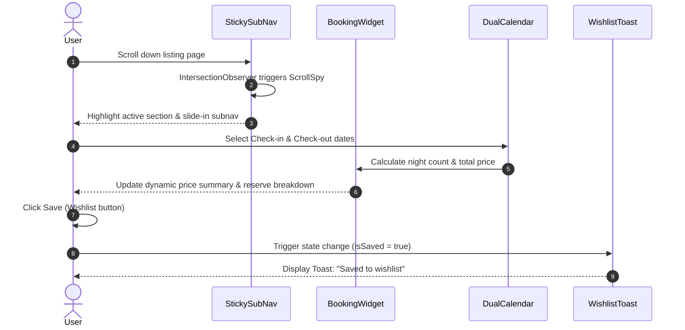

# Architecture Documentation: Airbnb Listing Clone

This document provides a comprehensive technical breakdown of the architecture, component structure, state management, and production cloud infrastructure for the **Airbnb Listing Page Clone**.

---

## 1. Application Component Architecture

The frontend is constructed with **Next.js App Router**, **React 19**, and **Tailwind CSS**. The interface is organized into a modular component hierarchy designed for responsive performance and high visual fidelity.

---

## 2. Production Cloud Infrastructure & Microservices

For a production-grade scale deployment, the platform follows a distributed, microservices-based cloud architecture to deliver sub-second search latency, high availability, and ACID-compliant transaction processing.

---

## 3. Dynamic State & Data Flow

---

## 4. Key Component Responsibilities

| Component | Responsibility | Key Features |
| :--- | :--- | :--- |
| **`GlobalHeader.tsx`** | Top primary navigation bar | Beló stroke-outline logo, search pill with house emoji, responsive profile/globe actions |
| **`StickySubNav.tsx`** | Secondary sticky navbar | Appears on scroll past hero grid; provides smooth ScrollSpy navigation to page sections |
| **`HeroGrid.tsx`** | Listing photo showcase | 5-image grid mosaic with hover overlay and triggers for Lightbox & Photo Tour |
| **`HostDetails.tsx`** | Host profile & information card | Host badge metrics, co-hosts grid, protection callout, and 3-column "Things to know" |
| **`ReviewsSection.tsx`** | Reviews & Ratings | 4.95 badge flanked by laurel wreaths, 6 sub-rating score columns with 26px icons, interactive tag filter pills, and expandable comments |
| **`BookingWidget.tsx`** | Pricing & Reservation card | Sticky floating widget with date picker inputs, guest selector, and fee breakdown calculations |
| **`DualCalendar.tsx`** | Multi-month date picker | Interactive check-in / check-out date selection with minimum stay rules |
| **`NearbyStaysCarousel.tsx`** | Related listings recommendations | Responsive 5-card horizontal slider with page pagination indicator (`1 / 2`) |
| **`WishlistToast.tsx`** | State feedback | Animated notification popup when saving/removing listing from wishlist |

---

## 5. Technology Stack & Design System

- **Framework:** Next.js (App Router, Server & Client Components)
- **Styling:** Tailwind CSS (Custom color tokens, responsive container breakpoints)
- **Typography:** Google Font **Plus Jakarta Sans** (Airbnb Cereal alternative)
- **Icons:** Lucide React & Handcrafted Inline SVGs
- **Build Tooling:** TypeScript 5, ESLint, PostCSS
